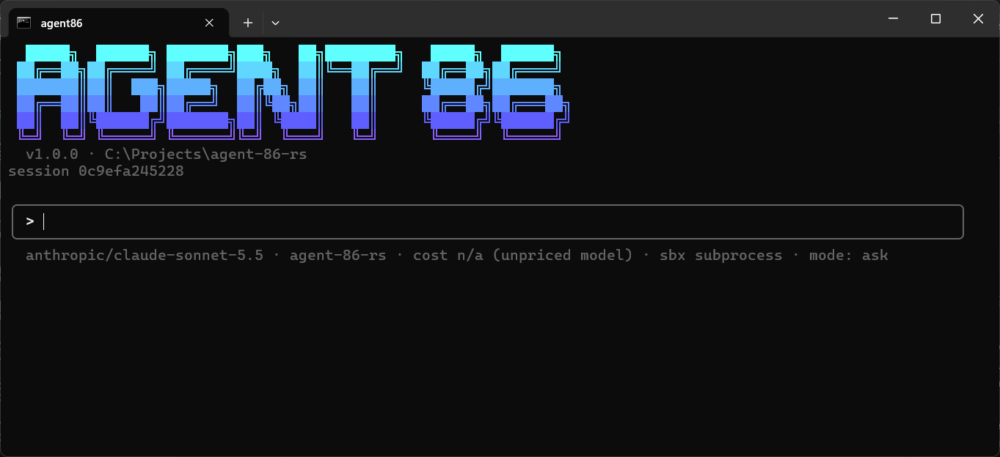

<p align="center">
  
</p>

# agent 86

An agentic harness on the command line. It connects to remote or local models and lets them use tools and skills, and ships as one native binary.

This is the standard agent86. It replaced the original [Python implementation](https://github.com/Maetek-Technologies/agent86-python), which is archived. It reads and writes the same config, sessions, memory, traces, and keyring entries, so you can switch from the Python version without losing anything.



## Status

**Everything the Python version did, and more.** agent86 has:

- Provider-neutral roles, phases, stop reasons, messages, tool calls, completions, steps, and usage accounting
- `provider:model` parsing
- Serde-based JSON representations and initial compatibility tests
- An async provider interface and an OpenAI-compatible streaming (SSE) provider for OpenAI, OpenRouter, and other compatible endpoints, with retries, timeouts, and secret redaction
- An Ollama provider for local models (`--model ollama:<model>`), streaming from `/api/chat` with tool calls, at no cost
- An Anthropic provider (`--model anthropic:<model>`) on the Messages API, with tool use, prompt caching, and the SDK's retries and error messages
- A llama.cpp and LM Studio provider (`--model llamacpp:<model>`), keyless and free, through the OpenAI-compatible adapter
- Recorded SSE fixtures and a local mock server, so provider tests need no credentials or network
- Layered TOML configuration (`~/.agent86/config.toml`, then `./.agent86/config.toml`, then `AGENT86_MODEL`, then `--model`) with the built-in OpenAI, OpenRouter, and Groq provider blocks
- Cost estimates from Python's price table, plus your own rates under `[pricing.models]`; models without a known price (including every OpenRouter model, as in Python) show `cost n/a`
- Python's system prompt (identity plus environment line), checked against text extracted from the Python source
- API keys from the provider's environment variable or, failing that, the OS keyring (service `agent86`, account = provider name), compatible with keys stored by the Python implementation
- A one-shot CLI: `agent86 --model provider:model run <goal>` prints the answer on stdout, with the tool calls and notices on stderr (`--output full` gives Python's single stream, `--output quiet` the answer alone; also `AGENT86_RUN_OUTPUT` and `[run] output`), and `run --json` prints one JSON object with `session_id`, `output`, `steps`, `usage`, `turn`, and `final` (the answer alone, beyond Python)
- An interactive interface (`agent86` with no subcommand), inline in Claude Code's style:
  - the conversation in your terminal's scrollback, a bordered input box, a spinner, a live status line, and approval panels
  - Python's slash commands with a `/` menu, `@file` mentions with path completion, and shared prompt history
  - pickers for the approval mode, the model (with the provider's live model list), and the session to resume
  - `/config model`: pick a provider, enter its key (kept in the OS keyring only after a live connection test passes), pick a model, and save it to your user or project config with your comments kept
  - `/config mcp`: add an MCP server from a pasted JSON block or by hand, test it live, save it, and use its tools at once; edit, disable, or remove servers the same way
  - answers rendered as Markdown, coloured diffs in approvals, and Ctrl+O for the full transcript with every tool call expanded
  - Esc or Ctrl+C to cancel a turn
  - `/limits` to see the step and output limits, change them for the session, or save them; when a turn or a sub-agent reaches one, the interface offers to raise it and carry on (beyond Python, where they are config-only)
  - `/secret NAME` to hand the agent a key, token, or password in a masked panel, held for the session or remembered for the project in the OS keyring; the model only ever sees its name (beyond Python)
  - Python's plain `agent86>` loop with `--plain` or piped input
- Formatting, linting, and tests on Linux, macOS, and Windows

`run` is a working agent for the current directory: the model can list, read, write, and edit files, run shell commands, run Python snippets, and fetch public web pages, see the results, and keep going until it answers. Commands run in a sandbox (workspace as the working directory, an environment with secrets removed, a timeout that kills the whole process tree, and capped output), or in a throwaway Docker container with `[sandbox] mode = "docker"`. Every write, command, and snippet needs your approval: at a terminal `run` asks `[y/N]` for each one; piped or in CI it declines them unless you pass `--yes` (or set `--approval auto`). Python's guardrails apply too: the goal is scanned for prompt injection and personal data, answers for leaked secrets and personal data (`[guardrails] egress = "redact"` rewrites them), and tool output that looks like injected instructions is marked as untrusted before the model sees it. `web_fetch` refuses private, loopback, and cloud-metadata addresses at every redirect. Every run is saved as a session in `~/.agent86/memory.db` (the same database and format as the Python implementation); `run --session <id>` continues one. A redacted flight recorder logs every turn, model call, tool call, and guardrail hit to `~/.agent86/traces/trace.jsonl`; `agent86 trace show` and `agent86 trace export` (JSONL, JSON, or OTLP JSON) read it back, and `[observability] otel = true` sends each turn, model call, and tool call as OpenTelemetry spans to a collector (OTLP over HTTP, honouring the standard `OTEL_EXPORTER_OTLP_*` variables) or to stderr. MCP servers (`[mcp.servers.<name>]`: a local `command` over stdio, or a `url` over streamable HTTP or the legacy SSE transport) are started for each run and their tools offered alongside the built-ins, behind the same approvals, plus resource, prompt, and completion tools for servers that declare them; a server that drops is reconnected, and `tools/list_changed` updates the tool list mid-run. `[mcp.servers.<name>.defaults]` adds arguments the model leaves out, by tool, for example `firecrawl_scrape = { maxAge = 0 }` so scrapes are never served from Firecrawl's cache (beyond Python). Each turn also tells the model the current date and time, so it can tell when a result is stale (beyond Python). `agent86 mcp list` and `agent86 mcp tools` show what is configured and what each server exposes. `agent86 models` lists the providers (and where each one's key comes from) and the model roles, `agent86 config path` shows which config files are read, `agent86 config show` prints the resolved configuration, and `agent86 skills list` and `agent86 skills show <name>` show the skills that were found. `--model`, `--sandbox`, and `--approval` go before the subcommand.

Run `agent86` with no subcommand for the interactive interface, the same agent over a conversation. Type `/` for a menu of its commands (`/model`, `/mode`, `/cost`, `/sessions`, `/resume`, `/clear`, and more); a bare `/mode`, `/model`, or `/resume` opens a picker. `@path` puts a file (or a directory listing) from the workspace straight into your message, and typing `@` offers matching paths. Escape or Ctrl+C stops a running turn at the next safe point and keeps what happened so far. Shift+Tab cycles the approval mode. Thinking models' reasoning shows as one line by default (`∴ thought for 12s · 2.1k chars`) and each tool call as two; Ctrl+T cycles the reasoning between `full`, `summary`, and `hidden`, `/thinking` and `/toolview` set how much reasoning and how much of each tool call is shown (`full` adds the arguments and the whole result), and `[ui] thinking` and `[ui] tool_use` set the defaults, which `/thinking save` writes for you (beyond Python). A failed tool call and every approval show whatever the level, and Ctrl+O always has everything. `agent86 --resume <id>` reopens a saved session. Prompts are remembered in `~/.agent86/history`, shared with the Python implementation. In place of Python's full-screen interface, the interface renders inline in Claude Code's style ([docs/INTERFACE.md](docs/INTERFACE.md)). `/config model` manages providers, keys, and models, and `/config mcp` adds, edits, tests, enables or disables, and removes MCP servers while the session runs. `--plain` (or `AGENT86_PLAIN`) gives Python's plain loop.

The agent has long-term memory in the same database. Every finished turn is recorded, and when a similar task comes up later, what happened last time is added to the model's context. The model can store durable facts with `remember` and look them up with `recall`. `agent86 memory stats|sessions|search|prune|forget` inspects and trims it, and old episodes and sessions are pruned at startup past `[memory]`'s retention caps. Text is embedded locally with Python's default model, `sentence-transformers/all-MiniLM-L6-v2`, run on [candle](https://github.com/huggingface/candle): it is read from (or, the first time, downloaded into) the same Hugging Face cache Python uses, and its vectors match Python's, so either implementation recalls what the other stored. `hash:<dim>` selects Python's offline hashing embedder, which is also the fallback when the model cannot load.

Skills work as in Python and Claude Code: a folder with a `SKILL.md` in `.agent86/skills` or `.claude/skills` (in the project or your home directory) is advertised to the model by name and description, and its full instructions load when the model calls `use_skill`. A skill's `allowed-tools` limits what may run while it is active, and files bundled with a skill can be read even outside the workspace. The model can also hand a focused subtask to a sub-agent with `delegate`: it runs with the same tools, approvals, and guardrails under its own step budget (`[agents]`), and what it spends counts toward the turn. The step budgets and the output cap can be raised for one run (`run --max-steps`, `--max-output-tokens`, `--max-agent-steps`) or for the session (`/limits`), and the interface offers to raise one when a turn or a sub-agent reaches it, for example when a thinking model spends its whole output cap reasoning. The interface shows a thinking model's reasoning dimmed as it streams, and a model that ends a turn with nothing to say is asked once more, after which its reasoning stands in for the answer.

Secrets never have to go through the chat (beyond Python). When the agent needs a key, a token, or a password, it calls `request_secret`, and you type or paste the value into a masked prompt (a panel in the interface, a hidden prompt at the terminal); `/secret NAME` enters one without being asked, `/secret` lists the names, and `/secret forget NAME` drops one. The value is held for the session unless you choose to remember it for this project (Tab in the panel, or the `[y/N]` question at a terminal): then it goes into the OS keyring, under a key made from the workspace's path, and is loaded again whenever agent86 starts at a terminal in that directory. `/secret` marks the remembered ones, and `/secret forget NAME` removes the keyring entry too. Without a keyring the choice is not offered, and a run with no terminal never reads or writes it. It reaches `run_command` and `python_exec` as an environment variable of that name (in the Docker sandbox too, passed by name so it never appears in a process list), `write_file` and `edit_file` write it wherever their arguments say `${secret:NAME}` (so the agent can put your key in `.env` without seeing it), and wherever it would show up in what the model, the history, the prompt history file, or the trace gets (tool output, your own messages, the model's reply), it is replaced by `${secret:NAME}`. This keeps secrets out of transcripts, provider logs, traces, and memory; it does not stop a hostile model, which could still get a transformed copy (base64, part of the value) past literal redaction. Piped and CI runs, where nobody can enter a value, are not offered the tool.

With `[model] router = "triage"`, each turn goes to the cheap model (`[model.route] cheap`) when the ask is short and plain, and to the frontier model otherwise, as in Python; `/model` pins one model for the rest of the session.

Long conversations are fitted to the model's real context window. When a session outgrows it, the oldest turns are replaced by a summary the model writes (goal, decisions, facts, open items), so a resumed session keeps its goal; the originals are archived in memory. `[limits] compaction = "drop"` drops them instead, and `max_context_tokens` caps the budget.

An Ollama model gets the `num_ctx` its Modelfile sets (`PARAMETER num_ctx 262144`), as it is; without one, the context window it was trained for, up to `[providers.ollama] num_ctx_max` (32768 by default, since Ollama allocates the whole window up front). Setting `num_ctx` in `[providers.ollama]` asks for exactly that size instead. Python always asks Ollama for 8192.

## Install

```sh
npm install -g agent86
```

npm installs the native binary for your platform (it needs Node.js 18 or newer only to install and launch it), and `npm install -g agent86@latest` updates it. Or download the archive for your platform from [Releases](https://github.com/Maetek-Technologies/agent86/releases), then extract it and put `agent86` on your `PATH`. Builds are available for Linux x86_64 and ARM64 (including 64-bit Raspberry Pi OS; glibc 2.35 or newer, so Ubuntu 22.04, Debian 12, or later), macOS on Apple silicon and Intel, and Windows x86_64. The binaries are unsigned: on macOS, run `xattr -d com.apple.quarantine agent86` once. To build from source instead, run `cargo install --git https://github.com/Maetek-Technologies/agent86 --tag v1.0.10` (needs Rust 1.88 or newer).

The interface and the plain loop check GitHub for a newer release at most once a day and say so when there is one; `/update` shows how to install it for the way you installed agent86, and `/update now` does it. `[ui] update_check = false` or `AGENT86_NO_UPDATE_CHECK=1` turns the check off, and `run` never checks.

To publish a release, add notes for it in `docs/releases/<tag>.md`, set the version in `Cargo.toml`, merge both, and push a `v<version>` tag. `.github/workflows/release.yml` then builds the archives and creates the release.

### Switching from the Python version

Uninstall it first (`pip uninstall agent86`, or `pipx uninstall agent86` if you installed it with pipx): both install a command named `agent86`, and whichever comes first on your `PATH` runs. Your `~/.agent86` config, sessions, memory, traces, prompt history, and keyring keys carry over as they are. [docs/PROJECT_PLAN.md](docs/PROJECT_PLAN.md) lists every way this version behaves differently.

## Why Rust?

agent86 began in Python and was rewritten in Rust for one native binary that needs no Python installation, fast startup, explicit typed state transitions, and a single async runtime for providers, tools, cancellation, and processes. The rewrite does not assume Python made model calls slow: model, network, tool, and I/O latency still dominate most workloads.

## Compatibility

The rewrite reproduced the Python version's observable behavior, checked by tests against fixtures produced from Python's own sources and CPython. What the two share stays compatible:

- CLI output streams (except `run`'s default, which keeps the tool calls off stdout; `run --output full` is Python's), exit codes, and `run --json`
- TOML configuration semantics
- The session and memory database, the trace format, the prompt history, and the keyring layout

Changes beyond the Python version are deliberate, and each is recorded in the project plan.

## Roadmap

- [x] Core provider-neutral vocabulary
- [x] Recorded provider fixtures and mock-server tests
- [x] OpenAI-compatible streaming provider
- [x] Ollama streaming provider
- [x] Anthropic and llama.cpp providers
- [x] Text-only one-shot `run` and `run --json`
- [x] Read-only workspace tools (`read_file`, `list_dir`)
- [x] ReAct loop with circuit breakers and continuations
- [x] Context-window fitting and compaction
- [x] Skills (`SKILL.md` folders in `.agent86/skills` and `.claude/skills`, `use_skill`, `allowed-tools`)
- [x] Delegation (`delegate` and sub-agents)
- [x] OpenTelemetry spans (`[observability] otel`, OTLP/HTTP or the console)
- [x] Triage routing (`[model] router = "triage"`: simple asks to `[model.route] cheap`, the rest to `frontier`)
- [x] The current time in each turn's prompt, and MCP default arguments (`[mcp.servers.<name>.defaults]`) (beyond Python)
- [x] Turn limits at runtime: `/limits`, `run --max-steps`, `--max-output-tokens`, and `--max-agent-steps`, and the interface's offer to raise a limit that was reached (beyond Python)
- [x] Secure secret entry, parts 1 and 2: `request_secret`, `/secret`, environment injection, redaction, and `${secret:NAME}` placeholders in the file tools (beyond Python)
- [x] Secure secret entry, part 3: remembering secrets per project in the OS keyring (beyond Python)
- [x] Arguments a model sends as JSON strings where the tool wants an array or an object are repaired (beyond Python)
- [x] Show or hide thinking and tool use in the interface: `full`, `summary`, or `hidden` for each, Ctrl+T and commands, `[ui] thinking` and `[ui] tool_use` (beyond Python)
- [ ] Scheduled jobs: the agent schedules work for itself, and `agent86 schedule daemon` runs it, with no session open (beyond Python; planned, see the project plan)
- [x] The standard agent86: public at `Maetek-Technologies/agent86`, with the Python implementation archived as `agent86-python`
- [x] A notice when a newer release is out, and `/update` to install it (beyond Python)
- [x] Install and update through npm (`npm install -g agent86`)
- [x] Reasoning: thinking models' reasoning shown dimmed in the interface, and a final reply with no text asked about once, then answered from the reasoning (beyond Python)
- [x] Reasoning guard: stray closing tags dropped from reasoning, reasoning stuck repeating itself stopped, and OpenRouter provider routing (`[providers.<name>.routing]`) (beyond Python)
- [x] Approvals and file-writing tools (`write_file`, `edit_file`)
- [x] Guardrails (ingress, egress, observation scanning)
- [x] Sandboxed command and Python execution (subprocess, or Docker)
- [x] `web_fetch` with SSRF protection
- [x] Sessions (save and resume, shared with Python)
- [x] Flight recorder (`agent86 trace path|show|export`)
- [x] Episodic and semantic memory (`remember`, `recall`, recall notes, retention, `agent86 memory`)
- [x] MCP client: stdio, streamable HTTP, and SSE transports, reconnects, `list_changed`, progress, and resource/prompt/completion tools (`agent86 mcp list|tools`)
- [x] Interactive REPL (Python's plain loop, slash commands, `@file` mentions, history, Ctrl+C cancellation)
- [x] Interactive terminal interface: inline, in Claude Code's style, with Python's commands, approvals, and management screens ([ADR 0001](docs/adr/0001-inline-terminal-interface.md))
- [x] Local embedding options (the sentence-transformers model on candle, and the hashing embedder)

Each stage should be dogfooded against the Python version before the next becomes the default path.

## Development

Install a current stable Rust toolchain, then run:

```bash
cargo test --all-targets
cargo fmt --all -- --check
cargo clippy --all-targets -- -D warnings
```

Try it against OpenRouter. Either set `OPENROUTER_API_KEY` in your environment, or store the key once in the OS keyring:

```bash
cargo run -- keys set openrouter      # prompts with input hidden, including in Git Bash
```

Then run:

```bash
cargo run -- --model openrouter:<model> run "Say hello"
cargo run -- --model openrouter:<model> run --json "Say hello"
cargo run -- --model openrouter:<model>                  # the interactive REPL
```

Any `[providers.<name>]` block with a `base_url` is treated as OpenAI-compatible; add `api_key_env` if the endpoint needs a key.

OpenRouter models have no built-in price. To see costs, add your model's rates (USD per million tokens) to `.agent86/config.toml`:

```toml
[pricing.models."openrouter:openai/gpt-4o-mini"]
input_per_mtok = 0.15
output_per_mtok = 0.60
```

OpenRouter may serve a model from a host that handles it badly, for example one whose thinking model writes stray tags and then repeats itself (agent86 stops such a loop and asks again). To keep the model off that host, pass OpenRouter's [provider routing](https://openrouter.ai/docs/features/provider-routing) preferences, which are sent as the request's `provider` field:

```toml
[providers.openrouter.routing]
ignore = ["Phala"]
```

## License

MIT, matching the reference implementation. See [LICENSE](LICENSE).
